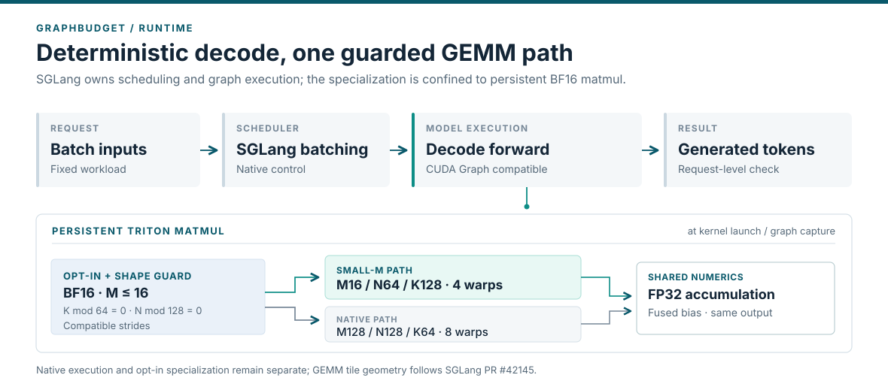
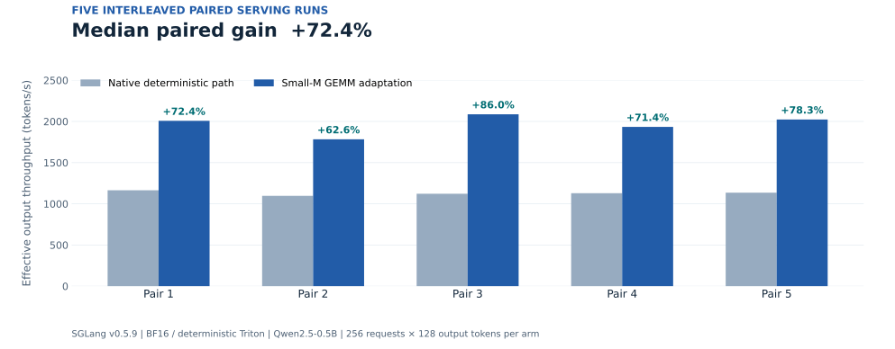
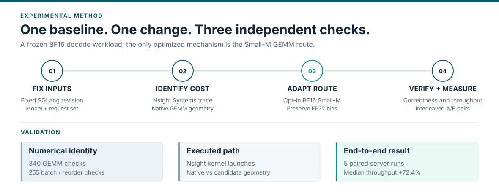

# GraphBudget

**SGLang 确定性解码性能优化** · [English](README.md)

GraphBudget 针对大语言模型确定性解码中的低延迟计算路径开展优化研究。当前已验证的核心成果是**可关闭的 BF16 Small-M GEMM 适配**，并提供执行路径观测、精确数值验证和请求级端到端对照实验。

| 性能结果 | 验证规模 | 测试范围 |
|:--|:--|:--|
| **+72.4%** 有效输出吞吐配对提升中位数 | **5** 组交错 A/B；**340** 项 GEMM 与 **255** 项重排检查 | SGLang v0.5.9 · Qwen2.5-0.5B BF16 · 确定性 Triton · 单 GPU |

**结果边界：** 该数值比较的是固定版本、同配置的原生确定性 Triton 路径与 Small-M GEMM 适配路径，仅对应所测工作负载，不代表所有 SGLang 版本、模型或运行环境的通用加速。



## 核心优化

小 Batch 解码时，部分 BF16 GEMM 只有很少的输出行。项目在固定版本的 SGLang Runtime 中根据 dtype、形状和 Stride 条件，选择适合小 $M$ 的 persistent Triton GEMM 配置。未满足条件的调用继续使用原生路径。

| 维度 | 原生确定性路径 | Small-M 候选 |
|:--|:--|:--|
| GEMM Tile (M / N / K) | 128 / 128 / 64 | 16 / 64 / 128 |
| Warp 数 | 8 | 4 |
| 数值语义 | 原生 persistent Triton、FP32 fused bias | 保留原数值契约和原生回退 |
| 执行选择 | 原生逻辑 | 显式开关 + dtype、形状与 Stride 条件 |

分块方案参考 [bill-h-lin 的 SGLang PR #42145](https://github.com/sgl-project/sglang/pull/42145)，并适配到 SGLang v0.5.9 的 Triton 执行路径和 fused-bias 语义。本项目展示的工程工作是固定版本 Runtime 适配、性能分析、正确性与端到端验证；不将上游 Tile 构思作为原创 GEMM 算法。

## 性能结果与证据



正式实验采用 AB / BA / AB / BA / AB 五组交错配对；每个实验臂包含 **256 个固定请求，每个请求输出 128 Token**。五组配对相对变化的中位数为 **+72.4%**。前后 A/A 的最大变化为 **8.8%**，仅用于描述有限的实验波动，并非置信区间。

所测请求输出逐 Token 一致；Nsight Systems 进一步证实 persistent GEMM 的实际启动配置发生变化。性能数字取自没有开启 Profiling 的请求级测量，而非 Trace 时间估算。

[中文技术报告（PDF）](docs/reports/GraphBudget_Technical_Report_ZH.pdf) · [English Technical Report (PDF)](docs/reports/GraphBudget_Technical_Report_EN.pdf) · [原始配对结果](https://github.com/yu830/graph-budget-runtime/blob/1f1984147608ee6c5dd8b3423e6f41877aaadeb4/docs/PERFORMANCE_RESULTS_20261027.md)

## 实现与验证方法



可复现的实现固定于[性能交付提交](https://github.com/yu830/graph-budget-runtime/tree/1f1984147608ee6c5dd8b3423e6f41877aaadeb4)，包含 SGLang 可关闭补丁、版本锁定环境、CPU/GPU 正确性测试、真实执行 Trace、请求级配对评测和结构化统计。

| 内容 | 链接 |
|:--|:--|
| SGLang 集成 Patch | [固定源码](https://github.com/yu830/graph-budget-runtime/blob/1f1984147608ee6c5dd8b3423e6f41877aaadeb4/src/graphbudget/patches/sglang-v0.5.9.patch) |
| 正式配对结果 | [机器可读 JSON](https://github.com/yu830/graph-budget-runtime/blob/1f1984147608ee6c5dd8b3423e6f41877aaadeb4/results/2026-10-27-performance/formal07-summary.json) |
| 环境与复现步骤 | [性能分支 README](https://github.com/yu830/graph-budget-runtime/blob/1f1984147608ee6c5dd8b3423e6f41877aaadeb4/README.md) |
| 完整性能报告与消融 | [原始实验记录](https://github.com/yu830/graph-budget-runtime/blob/1f1984147608ee6c5dd8b3423e6f41877aaadeb4/docs/PERFORMANCE_RESULTS_20261027.md) |
| 技术分析与结果归属 | [中文技术讲解](https://github.com/yu830/graph-budget-runtime/blob/1f1984147608ee6c5dd8b3423e6f41877aaadeb4/docs/PERFORMANCE_WALKTHROUGH_ZH.md) |
| LaTeX 技术报告源文件 | [中文](docs/reports/GraphBudget_Technical_Report_ZH.tex) · [English](docs/reports/GraphBudget_Technical_Report_EN.tex) |

报告使用 XeLaTeX 编译。进入 `docs/reports/` 后执行：

```bash
xelatex GraphBudget_Technical_Report_ZH.tex
xelatex GraphBudget_Technical_Report_EN.tex
```

图表以 SVG、PDF 矢量格式存储。架构图表达真实代码模块之间的逻辑关系；CUDA Graph Replay 沿用 Capture 阶段确定的 Kernel Launch，不会逐 Token 重新分派。

## 验证边界与相关实验

主收益只适用于已测模型、GPU 与确定性 BF16 工作负载。先前 CUDA Graph 成本策略和 Decode Metadata 预分配／融合没有建立稳定端到端增益；Holdout 的首 Token 延迟变化方向不一致，硬件占用率与带宽计数器也未完成验证。详细结论保留在[中文技术报告](docs/reports/GraphBudget_Technical_Report_ZH.pdf)与[原始实验记录](https://github.com/yu830/graph-budget-runtime/blob/1f1984147608ee6c5dd8b3423e6f41877aaadeb4/docs/PERFORMANCE_RESULTS_20261027.md)。

## 来源与许可证

本项目原创材料采用 [Apache-2.0](LICENSE)；SGLang 和第三方材料保留其原许可证与归属（见[第三方归属声明](https://github.com/yu830/graph-budget-runtime/blob/1f1984147608ee6c5dd8b3423e6f41877aaadeb4/THIRD_PARTY_NOTICES.md)）。Small-M Tile 几何方案明确归属 SGLang PR #42145，不视为独立发明。
